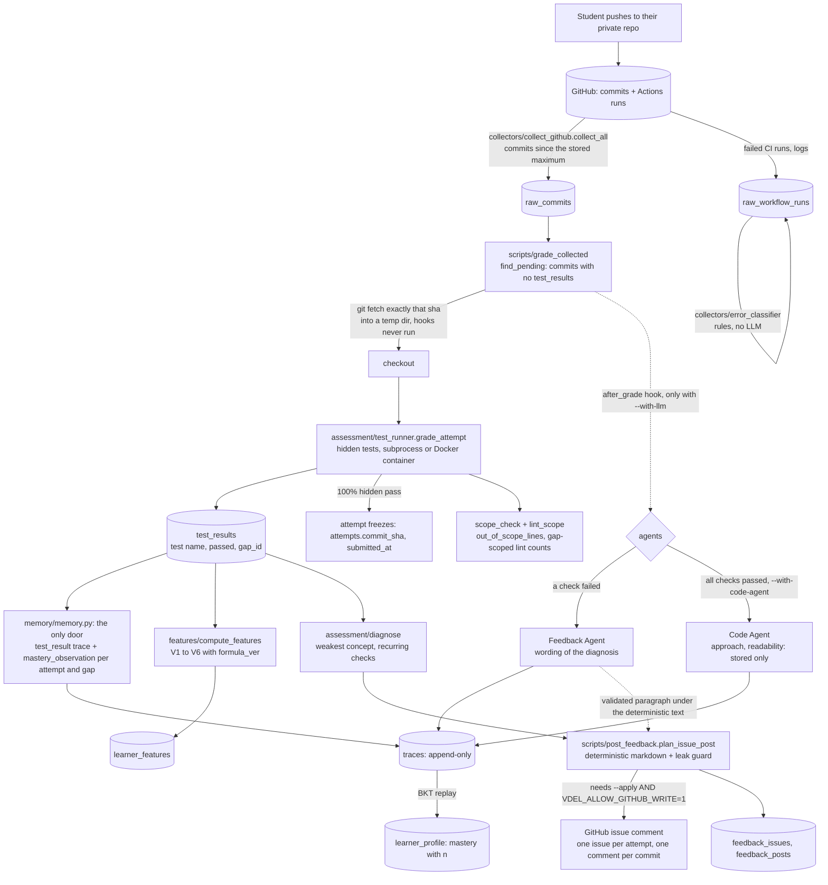
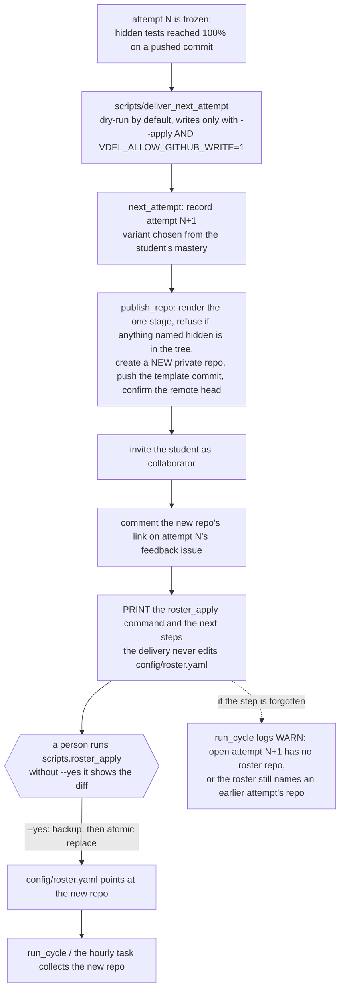

# ARCHITECTURE.md

How the system fits together, written from the code (module docstrings and the decisions in
[DECISIONS.md](DECISIONS.md), cited as D-nnn). Contents: 1 The idea · 2 From a commit to a comment ·
3 From a delivery to the roster · 4 Module map · 5 The data model · 6 The invariants ·
7 Deterministic and LLM, side by side · 8 What is not built

## 1. The idea

Three rules shape everything.

1. **Event sourcing.** `traces` is an append-only log of everything that happened (a database rule rejects
   `UPDATE` and `DELETE`). `learner_profile` is the *current belief* derived from it. Arrows run one way,
   traces to profile: wipe the profile, replay the traces, get the identical profile back
   (`python -m scripts.prove_event_sourcing`, and Beat 7 of the demo).
2. **Land raw first.** `raw_commits` and `raw_workflow_runs` are never overwritten. Feature formulas change
   (every `learner_features` row carries its `formula_ver`) and history can only be recomputed because the
   raw events were kept.
3. **A blackboard, not a conversation.** Components never call each other; each reads shared state from
   PostgreSQL and writes a structured row back. A database row is inspectable; a conversation is not.

Correctness has one source: **hidden tests that were executed** (D-036, D-045). An LLM may explain a result;
it may never assert one.

## 2. From a commit to a comment

What the diagram leaves out, and the reasons behind it:

- **One command runs the left-hand half.** `scripts/run_cycle.py` does collect, grade, features and profile
  for every student in the roster, each stage a separate unit of work and each student isolated from the
  others; `scripts/run_hourly.py` is the cycle followed by the feedback phase, under a Postgres advisory
  lock, and is what the scheduled task runs. Both are idempotent: a second run with nothing new writes
  nothing.
- **Which attempt a commit belongs to.** The collector attributes a commit to an assignment by the files it
  touched (D-043); a commit touching none, or several, has `assignment_id IS NULL` and is not graded. Within an
  assignment an open attempt beats a frozen higher one (D-072, and `docs/KNOWN_ISSUES.md` 1).
- **After the freeze** later commits are collected but not graded as evidence (D-069). The template push of a
  delivered repo is not a student action (D-098).
- **One mastery observation per (attempt, gap):** the first attempted pushed commit (D-079). Only gaps the
  attempt hid count (D-054). A collection error or timeout is not evidence (D-069).
- **Agents are optional and never decisive.** The Feedback Agent's paragraph is added *under* the
  deterministic text and only after passing a validator and a hidden-source leak check; the Code Agent's
  verdict is stored and read by an internal report, never posted, never fed to mastery (D-061, D-104).
  Both draw on one call budget and are wrapped in a hard cap at the provider handler (D-104).
- **Feedback shows the test name and the exception type, never the assertion text** (D-077).

## 3. From a delivery to the roster

The roster is a person's step on purpose (D-090): it decides what is collected and graded, so an edit is
shown, backed up and confirmed. A delivery that stopped half way is finished with the same command plus
`--resume`; every GitHub step is idempotent. `--force` (deliver before the current attempt is frozen) needs
`--i-understand`, because the old attempt stays open (`docs/KNOWN_ISSUES.md` 1).

## 4. Module map

| Directory | What is in it | Notes |
|---|---|---|
| `system/` | `db.py` (the one place a connection is opened), `llm.py` (the gateway) | **Every LLM call goes through `llm.py`** (temperature 0, one corrective retry, schema validation, fallback chain, 30 s timeout, cache) |
| `collectors/` | `collect_github.py`, `error_classifier.py` | GitHub to raw tables, idempotent; the classifier maps a failed run to a taxonomy concept or leaves it unclassified |
| `variables/` | `mastery.py` (V1), `habits.py` (V2, V3), `pace.py` (V4), `error_response.py` (V5), `error_frequency.py` (V6) | The formulas, transcribed from the module documents; pure functions, no I/O |
| `features/` | `compute_features.py` | Raw tables to the variables; `FORMULA_VER` is `v8` |
| `memory/` | `memory.py` | **The only door to `traces` and `learner_profile`**; the fast path (BKT) and the rebuild-from-traces live here |
| `assessment/` | `gap_parser.py`, `gap_generator.py`, `test_runner.py`, `scope_check.py`, `lint_scope.py`, `diagnose.py` | Master files to gaps, deterministic variant choice, hidden-test execution, scope and lint measurement, the diagnosis |
| `agents/` | `feedback_agent.py`, `code_agent.py`, `pipeline.py`, `validation.py`, `prompts.py`, `tools.py`, `scope.py`, `budget.py`, `resources.py`, `fake_llm.py`, `echo_agent.py` | `PROMPT_CHANGELOG.md` versions the prompts; `fake_llm.py` scripts the provider handlers for tests |
| `scripts/` | one file per command | `run_cycle`, `run_hourly`, `grade_collected`, `post_feedback`, `deliver_next_attempt`, `roster_apply`, `publish_repo`, `seed_data`, `init_db`, `doctor`, `baseline`, `demo`, `code_agent_report`, `llm_first_call`, ... ; `scripts/windows/` holds the Task Scheduler scripts |
| `config/` | `concepts.yaml` (the taxonomy), `judging.yaml` (criteria per assignment), `resources.csv`, `roster.example.yaml` | Concept ids are **schema**: they appear in columns, prompts and error mappings |
| `curriculum/master/` | `weather_etl`, `sales_analyzer` | Master solutions with `# @gap:` markers, `tests/hidden`, `tests/visible` ([AUTHORING.md](AUTHORING.md)) |
| `sql/` | `01` to `10`, applied in the order of `scripts/init_db.py` | All additive and idempotent |
| `benchmark/` | `submissions/`, `ground_truth.json`, `run_benchmark.py`, `run_real_benchmark.py`, `RECOMMENDATION.md` | The judge's test suite; the real run is billed and capped |
| `docker/` | `grader.Dockerfile`, `grader-requirements.txt` | The grading container |
| `dags/` | `vdel_pipeline.py` | An Airflow DAG that has never run here (`docs/KNOWN_ISSUES.md` 16) |
| `tests/` | one file per module or decision | The suite builds its own `<db>_test` database |

## 5. The data model

Nineteen tables (`python -m scripts.doctor` checks them). Grouped by who writes them:

| Group | Tables | Written by |
|---|---|---|
| Reference | `students`, `assignments`, `projects`, `gaps`, `variants` | `scripts/seed_data`, `render_student_repo` |
| Raw (never overwritten) | `raw_commits`, `raw_workflow_runs` | the collector |
| Attempts and results | `attempts`, `test_results`, `activity_sessions` | the renderer, the grader |
| Derived | `learner_features`, `kt_params`, `sessions` (superseded by `activity_sessions`, D-040) | `compute_features`, seed |
| Memory | `traces` (append-only), `learner_profile` (mutable belief) | `memory/memory.py` only |
| Feedback | `feedback_issues`, `feedback_posts` | `scripts/post_feedback` |
| Resources | `resources` (a curated table instead of a RAG chatbot, D-038) | `scripts/load_resources` |
| Superseded | `items` (replaced by `variants.difficulty`, not dropped, D-044) | nothing |

`traces` columns: `student_id`, `actor` (`code_agent`, `coach`, `system`, ...), `kind` (`test_result`,
`mastery_observation`, `verdict`, `intervention`, `profile_update`, ...), `assignment_id`, `concept_ids`, a
JSONB `payload`. The set of kinds is validated in code, and each is classified as mastery evidence or not
(`memory/memory.py`, `NON_MASTERY_KINDS`): a `verdict` and an `intervention` can never move mastery.
Every mastery estimate ships with its observation count `n`: 0.9 from n=2 is a rumour, from n=20 a fact.
Why JSONB for the profile: its inner structure changes while the system is young, and PostgreSQL still gives
indexing and transactions.

## 6. The invariants

These sixteen rules are enforced by tests, lint, or the structure of the code. They are the first thing to
check in a review.

1. `traces` is append-only: insert only, a rule rejects update and delete.
2. Agents never write SQL to memory; everything goes through `memory/memory.py`.
3. Every LLM call goes through `system/llm.py`; ruff's banned-import rule fails the build otherwise.
4. Temperature 0 for judging; `judge()` has no temperature parameter at all.
5. Every LLM output is schema-validated, with one corrective retry, then flagged; never silently dropped.
6. Every rubric score carries verbatim evidence quotes, string-matched against the submission; a fabricated
   quote rejects the verdict.
7. The submission is data, never instructions: it sits between delimiters that are escaped inside it.
8. Every mastery estimate ships with its observation count `n`.
9. Collectors and loaders are idempotent (`ON CONFLICT`).
10. An unclassified error updates no mastery, and the match rate is logged.
11. Secrets live in `.env` (gitignored); `.env.example` is committed, names only.
12. No agent ever executes submitted code. The tool stage is static only (ruff, sqlfluff, AST).
13. Correctness is decided by executed tests, never asserted by an LLM. (Compatible with 12: tests run in
    `assessment/test_runner.py`, a separate process that imports nothing from `agents/` or `system/llm.py`;
    an agent only reads the resulting rows. 12 is about trust boundaries, 13 about where authority lives.)
14. All static analysis is gap-scoped; findings outside the gap lines are never attributed to the student.
15. Every gap, variant and attempt pins its `master_version`; line numbers are valid for one master only.
16. A `Not Equivalent` verdict must carry a counterexample input (the differential runner is not built, so
    this is a rule waiting for its component).

## 7. Deterministic and LLM, side by side

| Step | How it is done | Deterministic? |
|---|---|---|
| Collection, attribution to an assignment, freeze | GitHub API, file paths, hidden-test result | yes |
| CI error classification | a rule table in `error_classifier.py` | yes |
| Grading | hidden tests executed in a subprocess or container | yes (modulo test timing) |
| Mastery (V1), V2 to V6, the diagnosis | BKT and the formulas in `variables/` | yes |
| Which gaps a student gets | seeded selection from mastery (`gap_generator`) | yes |
| The feedback comment | `post_feedback` builds the text from test names and exception types | yes |
| A paragraph added under the comment | Feedback Agent, validated, leak-checked, **optional** | **no (LLM)** |
| Approach, readability scores | Code Agent, with quoted evidence, stored, **never shown** | **no (LLM)** |
| The weekly natural-language reflection | planned (`reflection_run` kind exists); the job is not built | n/a |

The LLM is never asked whether the code is correct, never sees the hidden tests, their names or results (the
Code Agent) or their source (either agent), and cannot post anything by itself.

## 8. What is not built

Differential execution (D-036 designed, not built), the Reviewer and orchestrator, Performance and Pedagogy
agents (dropped), the Coach, the knowledge graph and retrieval from the tutor-side collaborator, a cron/systemd scheduler
script, an Airflow run, and any measurement of the Code Agent on `weather_etl`. The full list with impact is
[KNOWN_ISSUES.md](KNOWN_ISSUES.md).
