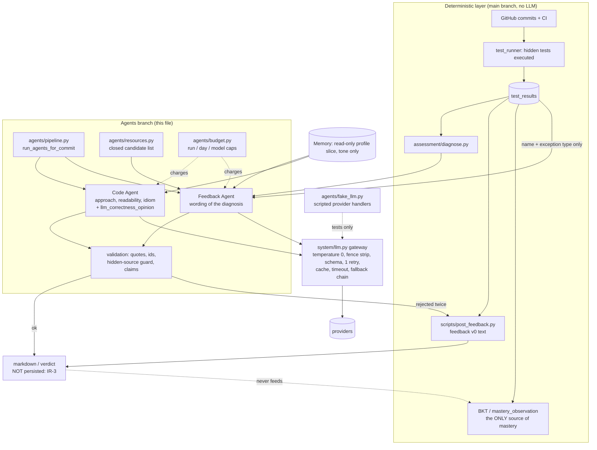

# VDEL agents: inventory, contracts, integration requests

Branch `feature/agents`. This file is owned by the agents branch. Decisions taken on this
branch are in `docs/DECISIONS_AGENTS.md` (D-200 and up, so they never collide with
`docs/DECISIONS.md` on main).

Contents: 1 Inventory · 2 Gateway interfaces · 3 Fake LLM harness · 4 Code Agent · 5 Feedback
Agent · 6 Resources · 7 Pipeline · 8 Budget · 9 Benchmark · 10 Architecture and rules ·
11 Integration requests · 12 Later

---

## 1. Inventory (state of the branch at the start of the night)

### 1.1 Agents that exist

| Agent | File | Calls an LLM | Inputs | Output | Trace written |
|---|---|---|---|---|---|
| Code Agent | `agents/code_agent.py` (`grade`) | yes, one `llm.judge` per submission | `mem`, `student_id`, `assignment` dict (`assignment_id`, **`task`** required, `concepts`), `code_path`; keyword: `profile_snapshot`, `reference`, `parent_trace_id`, `conn` | `(Verdict, trace_id, evidence_failures or None)` | `actor="code_agent"`, `kind="verdict"`; payload = `Verdict.model_dump()` + `agent="code_agent_v1"`, `prompt_version`, `provider`, `model`, `flagged`, `tool_reports`, `reference_supplied` |
| Echo Agent | `agents/echo_agent.py` (`grade`) | no (rule based) | same first four params, plus `ci_conclusion` (required) | `(EchoVerdict, trace_id, None)` | `actor="code_agent"`, `kind="verdict"`, `agent="echo_v1"`, `evidence_source` |
| (support) validation | `agents/validation.py` | no | verdict + code text | list of failures; `rejects_verdict` | none |
| (support) tools | `agents/tools.py` | no | a file path | `ToolReport`s (ruff, sqlfluff), static only | none |
| (support) prompts | `agents/prompts.py` | no | task, code, linter text, mastery slice | one prompt string; `PROMPT_VERSION` | none |

There is **no Feedback Agent on main**: `scripts/post_feedback.py` is "feedback v0", a
deterministic text builder (no LLM). The Feedback Agent is built on this branch (section 5).

### 1.2 Details per agent

**Code Agent.** Five stages (`CLAUDE.md` §8): tools (ruff/sqlfluff, never executes the code),
assemble (task, rubric, linter facts, mastery slice marked tone-only, optional reference, the
code between `<<<BEGIN SUBMISSION>>>` delimiters), judge (one `llm.judge(prompt, Verdict)`),
validate (every evidence quote string-matched against the code), commit (a verdict trace, then
`update_mastery`, which replays `ci_run` / `mastery_observation` and ignores the verdict).
Schema: `Verdict` = `evidence`, `scores` (4 criteria, 0..4), `misconceptions`,
`feedback_for_student`, `confidence`, `evidence_failures`. Prompt version `v1` (at inventory
time) in `agents/prompts.py`; changelog `agents/PROMPT_CHANGELOG.md`. Called from
`scripts/demo.py` (Beat 6) and `benchmark/run_benchmark.py`. **Not called from `run_cycle`.**
Hidden tests and test results are not given to it (section 4.4).

**Echo Agent.** Tracer bullet, no LLM. Maps a CI conclusion to a verdict (correctness 4/0, the
rest 2, `confidence="low"`). Only used by tests today; its shapes exist so the Code Agent is a
swap of internals.

### 1.3 Cut by design (and why)

| Component | Status | Why |
|---|---|---|
| Reviewer (`agents/reviewer.py`, pure-Python arithmetic + objective-vs-LLM disagreement flag) | LATER (M6) | needs at least two agents to aggregate; `CLAUDE.md` §3; `VDEL_REDESIGN.md` §13 lists it as Phase 4 |
| Orchestrator (`system/orchestrator.py`) | LATER (M6) | same reason; the snapshot rule (H.2) is reserved in `Memory.snapshot_profile`. `agents/pipeline.py` (section 7) is a deliberately small stand-in, not the M6 orchestrator |
| Performance + Pedagogy Agents | DROPPED (M5) | overlap folds into the Code Agent's idiomatic criterion; revisit when course materials and Hanafi's SKG v1 exist (`CLAUDE.md` §3, `VDEL_REDESIGN.md` §15) |
| Coach (M7), Execution agent, Data Quality agent | STRETCH / not built | gated on M6 and personas |
| LLM-asserted correctness | REMOVED | D-036 / invariant 13: correctness is decided by executed hidden tests |

### 1.4 Built / half-built / missing

| Piece | State | Notes |
|---|---|---|
| Gateway `system/llm.py` (judge, generate, cache, fallback chain, timeout, fence stripping) | built | section 2 |
| Code Agent | built, **half-wired** | works with a live key; not in `run_cycle`; field `correctness` is the model's opinion (renamed on this branch, section 4) |
| Echo Agent | built | tests only |
| Validation (evidence quotes) | built | |
| Tools (ruff/sqlfluff) | built | |
| Diagnosis `assessment/diagnose.py` | built (main) | feeds the Feedback Agent |
| Feedback v0 `scripts/post_feedback.py` | built (main), dry-run only | deterministic fallback of the Feedback Agent |
| Feedback Agent (LLM) | **built on this branch** (section 5) | not wired anywhere on main |
| Fake LLM harness | built on this branch (section 3) | no test could script an LLM before |
| Resources table | schema built, **0 rows** in the real DB | loader + template on this branch (section 6) |
| Resource selector | built on this branch | |
| Budget guard | built on this branch (section 8) | |
| Agents entry point | built on this branch (section 7) | not called by `run_cycle` |
| Persisting agent output | **missing** | integration request IR-3 |
| Benchmark ground truth | **missing**: `benchmark/ground_truth.json` is all `null` | needs the author's hand labels; labeling sheet generated (section 9) |
| Judge-vs-tests agreement (C8) | missing | needs real labels and live runs |
| Reviewer, Orchestrator, Perf, Pedagogy, Coach | missing (cut) | 1.3 |

---

## 2. `system/llm.py` public interfaces (exact)

```python
llm.PROVIDER: Provider            # read once at import from LLM_PROVIDER (default "anthropic")
llm.MODEL_TIERS                   # {"default"|"cheap": {Provider: model id}}
llm.CACHE: dict[str, str]         # in-process, key = sha256(f"{provider}:{model}:{temperature}:{prompt}")
llm.COST_LOG: list[CallRecord]    # every call, incl. retries and failures

judge(prompt: str, schema: type[T], *, model_tier="default", model=None, use_cache=True)
    -> tuple[T, CallRecord]       # NO temperature parameter: temperature 0 is the only value
generate(prompt: str, *, temperature: float, model_tier="default", model=None, use_cache=True)
    -> tuple[str, CallRecord]     # must never be called from agents/

class SchemaValidationError(RuntimeError):   # .records: list[CallRecord], .raw_prefixes: list[str] (300 chars)
class CallRecord(BaseModel): ts, provider, model, temperature, tokens_in, tokens_out,
                             elapsed_s, cache_hit, attempt, schema_valid, flagged
```

Behaviour of `judge`:

* **Fence stripping** (`_strip_one_code_fence`, D-059): one surrounding markdown fence that
  wraps the whole response (optional language tag) is removed before validation. A fence that is
  not the whole reply (prose before it, missing closing fence) is left alone and fails
  validation. Only one fence, never a loop. The cache and cost log keep the raw text.
* **Validation + one corrective retry** (D-022): `schema.model_validate_json`. On failure a
  second call is made with `_CORRECTIVE_SUFFIX` appended; if that also fails,
  `SchemaValidationError` is raised (never a default value). Both attempts are in `COST_LOG`
  (`attempt` 1 and 2, `schema_valid`, `flagged`).
* **Cache**: on by default, per (provider, model, temperature, prompt). Cache hits cost
  nothing and are flagged `cache_hit=True`. A fallback model's answer is never cached under the
  primary model's key. The benchmark must pass `use_cache=False`.
* **Timeout** (D-051): every provider handler runs in a thread pool and is abandoned after
  `_PROVIDER_CALL_TIMEOUT_S = 30` seconds (`_ProviderCallTimeout`, classified `transient`).
* **Fallback chain** (D-04X, `_call_with_fallback`): layer 1 = other models of the same provider
  (`_model_chain`, default then cheap tier, `TODO(verify)` ids skipped, at most 3 models);
  layer 2 = up to 2 other providers **that have an API key in the environment**. Error classes
  from `_classify_transport_error`: `quota_billing` (skip the rest of the provider),
  `transient` (next model), `unknown` (next model, then other providers). `NotImplementedError`,
  `ValueError`, `TypeError` are never retried. If everything fails: `RuntimeError("every
  provider/model in the fallback chain failed...")`.
* **Providers**: anthropic (default), nvidia, google and openai are live; qwen_local is a stub
  (raises `NotImplementedError`). OpenAI's model ids were supplied by the author and have not been
  verified against OpenAI's public model list by this branch (D-225). A live smoke call, run by
  the author with the other providers' keys blanked, succeeded: `ok=True word='hello'
  provider=openai model=gpt-6.1-sol tokens_in=16 tokens_out=12 attempt=1`.
  raising `NotImplementedError`. Handler signature: `(prompt, temperature, model) ->
  (text, tokens_in, tokens_out)`; they live in `llm._PROVIDER_HANDLERS`.
* **Temperature**: omitted for models that reject a non-default value (D-025) and sent as `0.0`
  elsewhere.

Safety note for tests (found while reading): because of the layer-2 fallback, a test that fakes
only the primary handler and makes it fail would walk on to **real** providers whenever a key is
set in `.env`. The fake harness (section 3) therefore replaces all five handlers and disables key
discovery.

---

## 3. Fake LLM harness (`agents/fake_llm.py`) (D-202)

Fakes the **provider handlers**, not `llm.judge`, so the real gateway (fence stripping, schema
validation, corrective retry, cost log, cache, fallback, timeout) runs on top of scripted raw
text. Tests: `tests/test_agents_fake_llm.py`.

```python
fake = FakeLLM([invalid_json(), fenced_json({...})])   # one step per PROVIDER call
obj, record = fake.judge(prompt, Schema)                # same signature as system.llm.judge
with fake.installed():                                  # for code that calls system.llm directly
    code_agent.grade(...)                               # (Code Agent default path, the benchmark)
fake.call_count        # provider calls (cost)      fake.judge_count   # logical judge() calls
fake.prompts           # every prompt that was sent  fake.assert_exhausted()
```

Steps: `valid_json`, `fenced_json`, `invalid_json`, `truncated_fence`, `text(callable(prompt))`,
`provider_error`, `timeout` (the gateway's own timeout exception), `slow(seconds)` (exercises the
real thread timeout; the harness ceiling is 0.2 s while installed), `fail(exc)`. `sticky=True`
keeps a step at the head of the script (a provider that stays down). Content-level failures (a
quote that is not in the code, an invented `resource_id`, a cited test that is not in the
diagnosis) are ordinary `valid_json` replies with bad content; the agent tests build them.

Safety: all five handlers are replaced, key discovery is forced to `[]`, `PROVIDER` is pinned,
`generate` raises. An exhausted script raises `ScriptExhausted` (a `ValueError`, never retried).

---

## 4. Code Agent (hardened on this branch)

Tests: `tests/test_agents_code_agent.py` (32). Prompt version **v2** (`agents/PROMPT_CHANGELOG.md`).

**4a. `correctness` is now `llm_correctness_opinion`.** The score field of `Scores` was the
model's reading of the code, named like a result. It is renamed in the schema shown to the judge
(`OUTPUT_SCHEMA_BLOCK`), in `Scores`, and one sentence of the prompt says it is not a test result.
The rubric *criterion* keeps its name (`correctness` in `evidence`, `CRITERIA`,
`ground_truth.json`, the anchors). Compatibility:

* Reading: `Scores` accepts either key (`validation_alias`), `Verdict.model_validate(old_payload)`
  works, and `agents/trace_compat.py` (`correctness_opinion`, `normalise_payload`) reads a stored
  payload of either version. Stored traces are never rewritten (append-only).
* `Scores.correctness` remains as a read-only property so `scripts/demo.py` (forbidden file) keeps
  working unchanged. Writing always uses the new key; payload `agent` is `code_agent_v2`.
* Readers outside `agents/` that the other branch must move: IR-1 in section 11. A search of the
  non-test code found no reader of the stored `scores.correctness` key, only the attribute
  access in `scripts/demo.py` and `benchmark/run_benchmark.py` (the latter is fixed here).

**4b. Per-run call budget** (`agents/budget.py`, `CallBudget`, default 6 calls). `grade(...,
budget=...)` reserves the worst case of a judge (2 provider calls: one corrective retry) before
calling, raises `BudgetExceeded` with **no provider reached** if it does not fit, then settles to
the calls really made (cache hit = 0, success after retry = 2, double failure = 2). So the cap is
never exceeded, not even by a retry. `llm_client=` injects any object with `judge`'s signature.

**4c. Failure modes**, each tested through the fake provider with the real gateway on top: valid
JSON, fenced JSON, invalid then valid (retry), invalid twice (raises, **no trace**), a quote not in
the code (verdict flagged, trace still written), a whitespace-only difference (matches), missing
evidence (reported, not rejected), a provider that stays down (raises, no trace), a timeout
(raises, no trace), a real slow call (next model serves it), a reply with the old `correctness`
key (accepted).

**4d. What the Code Agent receives, and why.** Only: the task text, the rubric, ruff/sqlfluff
findings (static, never executes the code), the student's submission between
`<<<BEGIN SUBMISSION>>>` delimiters, optionally a reference solution, and a mastery slice marked
"tone only". It does **not** receive hidden test source, hidden test names, test results, pass
counts or exception messages. Why: (1) invariant 13 / D-036: correctness is decided by executed
tests, so the LLM has no business re-deciding it; (2) D-077: hidden test content must never reach a
student, and anything in a prompt can come back in a reply; (3) judging independence: if it saw the
results it would just echo them, and the planned judge-vs-tests agreement measurement (C8) would
measure nothing. Tests: `test_the_prompt_carries_no_hidden_test_source_and_no_test_results`,
`test_grade_has_no_parameter_through_which_tests_could_arrive`.

---

## 5. Feedback Agent (`agents/feedback_agent.py`, `agents/feedback_prompts.py`)

Tests: `tests/test_agents_feedback.py` (68). Prompt version `fb1`. **Writes to no database.**

### 5.1 Input contract (`FeedbackInput`, built by `gather_input` or `from_fixture`)

| Field | Source |
|---|---|
| `status`, `passed`, `total` | this commit's `test_results` rows (status precedence as `post_feedback`: tooling, collection_error, timeout, ok) |
| `failed`: test name + **exception type only** | same rows; the stored message is read only to extract the class (`post_feedback.exception_type`) then dropped (D-077); `FEEDBACK_SAFE_TESTS` is empty today and messages are not used at all |
| `weakest_concept`, `recurring_gaps`, `diagnosis_failing` | `assessment.diagnose.diagnose(cur, attempt_id)` (attempt-level history) |
| `concepts` (citable) | weakest concept plus the concepts of the failed checks' gaps |
| `mastery` slice | `Memory.get_profile(student_id, conn=cur.connection)`, read-only, joined to the caller's transaction; used for tone only |
| `candidates` | `agents/resources.py` selector for the weakest concept (section 6), or passed in |

No student code and no hidden test source is in the input or the prompt (the C10 text mentions
"plus the code"; this agent is stricter, see D-204).

### 5.2 Output schema (`FeedbackOutput`, pydantic, validated by the gateway)

`summary` (1..500 chars), `what_to_check_next` (1..3 items, each 1..240 chars), `cited_tests`,
`cited_concepts`, `resource_id` (candidate id or null), `confidence` (high|medium|low).
Temperature 0 (`judge` has no temperature parameter), gateway fence stripping and one gateway
corrective retry for schema errors.

### 5.3 Validation (`validate_output`, pure) and the fallback

Rejected, each with a rule name: `unknown_test` (cited test not among the failed checks),
`unknown_concept` (not in the diagnosis concepts), `unknown_resource` (not a candidate; with no
candidates only `null` is valid), `hidden_source` (any hidden test line, via the imported
`assert_no_hidden_source` / `hidden_source_lines`; the rejection carries no content and the line is
never copied into the retry prompt, the trace payload or the output), `correctness_claim` (the
code is correct / incorrect / buggy / works / "you nailed it": a pattern list, v1), `link_in_text`
(any URL: links come only from the resource row), `mastery_claim` (any "master/mastery/mastered").

Flow: judge, validate; on rejection ONE corrective judge call whose prompt names the broken rules;
a second rejection, a double schema failure, a provider error, a timeout or a spent budget all end
in the deterministic v0 text (`scripts.post_feedback.build_feedback`, imported, untouched). The
reason is recorded in `FeedbackResult.reasons`. The final markdown is checked once more for hidden
source before it is returned.

`collection_error`, `timeout`, `tooling` and "no failing check" make **no LLM call** (plain-words
v0 text, never a mastery claim, not counted as a wrong answer). See D-203.

### 5.4 Entry points

```python
build_feedback_with_llm(cur, attempt_id, commit_sha, llm, budget, *, memory=None, profile=None,
                        candidates=None) -> FeedbackResult        # cur: SELECTs only, no commit
run_feedback_agent(inp, llm, budget, *, hidden, fallback_markdown) -> FeedbackResult   # no DB
# FeedbackResult: .markdown .source .output (validated object or None) .reasons .rejections
#                 .calls_made .judge_calls .status .model .provider .input .to_trace_payload()
```

### 5.5 Persistence (not done here: IR-3)

`FeedbackResult.to_trace_payload()` is the proposed payload (the result remembers its `input`). Writing it needs no change to
`memory/memory.py`: the existing vocabulary has `actor="coach"` and `kind="intervention"`, which
is in `NON_MASTERY_KINDS` ("a hint given, not knowledge demonstrated"), so it can never feed BKT.
The exact call is in section 11, IR-3.

---

## 6. Resources

Tests: `tests/test_agents_resources.py` (39).

**Table (read-only inspection):** `resources(resource_id PK, concept_ids TEXT[] NOT NULL, kind,
title NOT NULL, locator, url, level)` with a GIN index on `concept_ids` (`sql/06`). The real
database has **0 rows**. No column was missing for what the agents need, so there is no
`sql/proposals/` file.

**Loader `scripts/load_resources.py`.** CSV columns `resource_id, concept_ids (a|b), kind, title,
locator, url, level`; template `docs/resources_template.csv` (two rows marked `EXAMPLE`, `.invalid`
URLs, nothing real). Validates against `config/concepts.yaml` (the brief names
`curriculum/concepts.yaml`, which does not exist), `kind` in `book_section|doc_page|kaggle|video`
(from the schema comment), `level` in `beginner|intermediate|advanced` (a choice, D-207), URL
syntax only (no network), duplicate ids and duplicate URLs. All errors are listed with line
numbers; any error means nothing is written. **Dry run by default** (touches no database). `--apply`
needs `--dsn` (never read from the environment), refuses a database not ending in `_test` unless
`--allow-real-db` is given, refuses `EXAMPLE` rows, runs in one transaction with
`ON CONFLICT (resource_id) DO UPDATE` (idempotent), deletes nothing.

**Selector `agents/resources.py: select_candidates(cur, concept_id, *, levels=None, limit=5)`.**
Rows containing the concept, optional level filter (rows with no level are kept), ordered beginner,
intermediate, advanced, unspecified, then `resource_id`; explicit `ORDER BY`, so the result does not
depend on row order. Read-only. `feedback_agent.gather_input(candidates=None)` uses it for the
weakest concept.

---

## 7. Agents entry point (`agents/pipeline.py`)

Tests: `tests/test_agents_pipeline.py` (13). Not called by `run_cycle` (IR-4 below).

```python
run_agents_for_commit(student_id, attempt_id, commit_sha, *, llm, budget, persist=False,
                      cur=None, memory=None, code_path=None, assignment=None, reference=None)
    -> PipelineSummary      # .steps{code_agent, feedback_agent}: status ok|skipped|failed, detail,
                            #   error, provider_calls, result;  .ok  .feedback_markdown
                            #   .dry_run_traces  .budget  .to_dict()
load_assignment_inputs(cur, assignment_id) -> (assignment dict, file_path)   # read-only helper
```

* **Fixed order**: Code Agent, then Feedback Agent. They do not read each other (blackboard rule).
* **Failure isolation**: each agent in its own `try/except`; a failure is a `failed` step with
  `ExceptionType: message`, never an exception out of the function. A spent budget is a failure of
  the Code Agent (`BudgetExceeded`) but only a deterministic fallback for the Feedback Agent.
* **`persist=True` raises `IntegrationPending` immediately**, before any read and any LLM call.
* **`persist=False` writes nothing**: the Code Agent gets `DryRunMemory` (profile reads go
  through; `log_trace` / `update_mastery` are only recorded in `summary.dry_run_traces`, with
  negative pseudo trace ids); the Feedback Agent has no write; a session the function opens itself
  is `readonly=True` at the Postgres level and rolled back.
* **Inputs the caller supplies**: `code_path` and `assignment` (with the task text). Without
  them the Code Agent step is `skipped` and the Feedback Agent still runs. `load_assignment_inputs`
  builds the dict the way `scripts/demo.py` Beat 6 does (the task = the gaps' instructions).
* One shared `CallBudget` covers both agents.

---

## 8. Cost and quota guard (`agents/budget.py`)

Tests: `tests/test_agents_budget.py` (27).

* **Unit of count: provider calls** (what costs money), not `judge()` calls. A judge is 1 call, 2
  with the gateway's corrective retry, 0 from the cache. Callers `charge(2)` (the worst case)
  before a judge and `settle(...)` afterwards: cache hit refunds both, a clean reply refunds one,
  a success after the retry arrives as one `attempt == 2` record and counts 2, a double schema
  failure counts the two records it carries, any other failure (`settle_unknown`) counts the whole
  reservation as model `unknown`. So no cap is ever exceeded, not even by a retry.
* **Per run**: `CallBudget(max_calls=6)` (default 6: one Code Agent run is at most 2 calls and one
  Feedback Agent run at most 4). **Per day**: `day_cap`, counted in a `UsageLedger` shared by all
  runs that use it. **Per model per day**: `model_day_caps` (refuses once a capped model has
  already reached its cap; the model is only known after a call). All refusals are
  `BudgetExceeded(cap="run"|"day"|"model")`, raised before any provider is reached.
* **Counting by model**: `CallBudget.by_model` (this run) and `UsageLedger.day_by_model()`.
* **Persistence**: memory only by default. `UsageLedger(path)` keeps a JSON file of counts only
  (no prompt, reply or student data), default path `.vdel/llm_usage.json`, written atomically.
  `.gitignore` gained `.vdel/` (a new path, so it was added rather than proposed). An unreadable
  file raises `LedgerCorrupt` (fails closed: unknown usage is not "zero usage").
* Wired in: the Code Agent raises `BudgetExceeded`; the Feedback Agent turns it into the
  deterministic fallback; the pipeline reports it per step.
* Limit (v1): two processes writing the same ledger file at the same moment can lose an update
  (read-modify-write without a lock). Listed in "Later".

---

## 9. Benchmark preparation (no live call)

Tests: `tests/test_agents_benchmark.py` (21).

* **Labeling sheet** `scripts/agents_make_labeling_sheet.py`: `submission_id, criterion, my_score,
  my_note, file`, one row per (submission, criterion) for the 5 benchmark files and the 4
  synthetic student files (`fixture:` ids); scores left empty for the author (0, 2 or 4, anchors
  via `--legend`). Ids and paths only: no code, no test content. Default output
  `benchmark/results/labeling_sheet.csv` (gitignored), never overwritten without `--force`.
  `--import-sheet` validates a filled sheet and writes ground-truth JSON in the template's shape
  to a path of your choosing; it refuses to overwrite `benchmark/ground_truth.json`.
* **Benchmark on the fake**: `run_benchmark.run()` is executed in the test database under
  `FakeLLM.installed()`: stable, noisy and JSON-failing judges, all sheet submissions, rolled back.
  Zero live calls.
* **Two real defects fixed in the benchmark path** (found by running it on the fake):
  1. `run_benchmark` called `grade()` with the gateway cache ON although `llm.judge`'s docstring
     says the benchmark must not: runs 2 and 3 were cache replays and "stability" measured a dict.
     `grade()` now takes `use_cache` (default True, unchanged) and the benchmark passes False.
  2. The benchmark never reported JSON validity or token counts. `_gateway_stats` now adds them
     (key `_gateway` of the results file) from the cost log.
* `benchmark/RECOMMENDATION.md`: method, metrics M1-M7, empty results (`TODO(measure)`), threats.

---

## 10. Architecture, rules, what is cut



Rules that hold everywhere (each is enforced by a test named in sections 4-9):

1. Correctness is decided only by executed tests (D-036). The LLM's reading is stored as
   `llm_correctness_opinion` and the Feedback Agent is rejected if it asserts correctness.
2. LLM output never feeds mastery. The agents write no trace on this branch; the proposed trace
   (`coach` / `intervention`) is in `NON_MASTERY_KINDS`; the Code Agent's `verdict` is too.
3. Every LLM score carries a string-matched quote (`validation.validate_evidence`).
4. The LLM never invents a resource: it picks a `resource_id` from a closed list or `null`; the
   text shown comes from the table row; links in model text are rejected.
5. No hidden test source reaches a student or a prompt (D-077). The existing guard is imported;
   failures are shown as test name + exception type only.
6. Temperature 0 (no way to say otherwise), one corrective retry, never a silent default.
7. Every call is counted and capped before it is made.

**Contracts at a glance.** Code Agent: `grade(mem, student_id, assignment, code_path, *, ...)
-> (Verdict, trace_id, failures)`, schema `Verdict`/`Scores` (section 4). Feedback Agent:
`FeedbackInput -> FeedbackOutput` + markdown (section 5). Pipeline: `PipelineSummary`
(section 7). Gateway: section 2. Budget: section 8.

**What is cut and why** is in section 1.3 (Reviewer, Orchestrator, Performance/Pedagogy, Coach).

---

## 11. Integration requests (changes needed in files this branch must not edit)

Each is something the main branch (or its owner) does when merging. Nothing here was applied.

### IR-1 `scripts/demo.py` lines 267 and 282: use the new field name

`Scores.correctness` still works (read-only alias), so demo.py is not broken. To stop using the
alias, replace `s.correctness` with `s.llm_correctness_opinion` on both lines:

```python
print(f"  LLM correctness estimate (not authoritative)={s.llm_correctness_opinion} "
...
f"LLM correctness estimate (not authoritative)={s.llm_correctness_opinion}, "
```

### IR-2 Readers of stored verdict payloads

A search of non-test code found no reader of `payload["scores"]["correctness"]`. Any reader added
later (a Reviewer, a dashboard, a report) must accept both keys. Use
`agents.trace_compat.correctness_opinion(payload)` or accept `"llm_correctness_opinion"` first and
`"correctness"` second. Optional, documentation only: add to the `NON_MASTERY_KINDS["verdict"]`
reason in `memory/memory.py` that the rubric's correctness field is an opinion
(`llm_correctness_opinion`), so mapping it to a BKT outcome would contradict D-036.

### IR-3 Persist the Feedback Agent's output (and, if wanted, the Code Agent's verdict)

No change to `memory/memory.py` is needed: `actor="coach"` and `kind="intervention"` already exist
and `intervention` is in `NON_MASTERY_KINDS` ("a hint given, not knowledge demonstrated"), so the
record can never feed BKT. In the caller, inside the transaction that owns the connection:

```python
from agents.feedback_agent import build_feedback_with_llm

result = build_feedback_with_llm(cur, attempt_id, sha, llm, budget)
if result.used_llm:                       # the deterministic text is reproducible: no row needed
    cur.execute(                          # idempotence: one row per (attempt, commit)
        "SELECT 1 FROM traces WHERE actor = 'coach' AND kind = 'intervention'"
        " AND payload->>'agent' = 'feedback_agent_v1' AND payload->>'commit_sha' = %s"
        " AND (payload->>'attempt_id')::bigint = %s", (sha, attempt_id))
    if cur.fetchone() is None:
        mem.log_trace(student_id, "coach", "intervention", result.to_trace_payload(),
                      assignment_id=assignment_id, concept_ids=list(result.input.concepts),
                      conn=cur.connection)
```

Posting to GitHub stays with `scripts/post_feedback.py` and its `VDEL_ALLOW_FEEDBACK_POST` gate;
this branch does not touch it. The Code Agent already persists through
`code_agent.grade(mem, ...)` when given a real `Memory`; `pipeline.run_agents_for_commit` runs it
on a `DryRunMemory`, and `persist=True` raises `IntegrationPending` until this is wired.

### IR-4 `--with-llm` in `run_cycle`, called after grading, with a daily budget

Today `scripts/run_cycle.py` prints "llm: NOT WIRED", and `scripts/grade_collected.py` deletes the
temporary checkout right after grading, so the student's file is gone before an agent could read
it. Two small changes, both in forbidden files.

(a) `scripts/grade_collected.py`, `run(...)`: add a parameter `after_grade=None` and call it
before the checkout is removed:

```python
def run(*, ..., checkout=checkout_commit, grade=grade_attempt, conn=None, after_grade=None):
    ...
            summary["graded"].append((p.attempt_id, p.sha, result.tests_passed,
                                      result.tests_total, result.frozen))
            if after_grade is not None and getattr(result, "status", "ok") == "ok":
                try:
                    after_grade(p, repo_dir, result)      # repo_dir is removed in `finally`
                except Exception as exc:  # noqa: BLE001 -- an agent must never fail the grading
                    summary.setdefault("agent_errors", []).append(
                        (label, f"{type(exc).__name__}: {exc}"))
```

(b) `scripts/run_cycle.py`: add `--llm-daily-cap N` (default 20, a number to confirm) and, in
`_run_locked`, replace the "NOT WIRED" message with:

```python
    after_grade = None
    if with_llm and not dry_run:
        from agents.budget import DEFAULT_LEDGER_PATH, CallBudget, UsageLedger
        from agents.pipeline import load_assignment_inputs, run_agents_for_commit
        from system import llm
        budget = CallBudget(max_calls=40, day_cap=llm_daily_cap,
                            ledger=UsageLedger(DEFAULT_LEDGER_PATH))

        def after_grade(p, repo_dir, result):
            assignment, file_path = load_assignment_inputs(conn.cursor(), p.assignment_id)
            summary = run_agents_for_commit(
                p.student_id, p.attempt_id, p.sha, llm=llm, budget=budget, persist=False,
                cur=conn.cursor(), code_path=repo_dir / file_path, assignment=assignment)
            out(f"  llm       {p.student_id}/{p.assignment_id} {p.sha[:7]}: "
                + ", ".join(f"{n}={s.status}" for n, s in summary.steps.items())
                + f"  (calls today: {budget.ledger.day_total()}/{llm_daily_cap})")
```

then pass `after_grade=after_grade` through `_stage_grade` to `gc.run`.

Notes: the cycle is the first place a real call can happen, so keep `--with-llm` off by default;
the per-run cap (40) and the daily cap are choices to confirm; a `BudgetExceeded` is reported per
step, never raised; keep `persist=False` until IR-3 is applied, then switch to `persist=True`
and make `run_agents_for_commit` call the IR-3 code (that part is the main branch's to write).

### IR-5 Public names this branch imports from forbidden files (keep them stable)

* `scripts/post_feedback.py`: `hidden_source_lines`, `assert_no_hidden_source`, `redact`,
  `HiddenSourceLeak`, `exception_type`, `short_test_name`, `build_feedback`.
* `assessment/diagnose.py`: `diagnose` and the `Diagnosis` / `FailingTest` fields
  (`weakest_concept`, `recurrence_flags`, `failing_tests[].test_name`).
* `memory/memory.py`: `Memory.get_profile(student_id, conn=)`, `Memory.log_trace`,
  `Memory.update_mastery`.
* `config/concepts.py`: `ids()`.

A rename of any of these breaks `tests/test_agents_*` and the agents. Moving them to a neutral
module is welcome but should leave the old names importable.

### IR-6 Repository hygiene

This branch edited `.gitignore` (added `!docs/agents.md`, `!docs/DECISIONS_AGENTS.md`,
`!docs/resources_template.csv`, `.vdel/`) and `pyproject.toml` (`extend-exclude` gained
`tests/fixtures/agents/code`, whose syntax-error fixture would otherwise fail `ruff check .`).
Neither is a forbidden file, but both are shared: check they merge cleanly.

---

## 12. Later (v1 scope: deliberately not protected against)

* Rare or hostile cases in the Feedback Agent: paraphrased correctness claims or other languages
  (`correctness_claim` is a short English pattern list); a model that smuggles a hidden line split
  over two lines or lightly reworded (the guard is an exact line match of at least 12 characters).
* `scripts/post_feedback.hidden_source_lines` includes generic lines such as `import requests`;
  any feedback containing that exact text is treated as a leak (safe direction, false positives).
* Student-level resource filtering (derive `levels` from mastery); resource freshness
  (a `verified_at` column); URL reachability checks.
* The Feedback Agent prompt has no student code and no gap-level hints; feedback that explains a
  specific mistake would need the gap region of the code, with its own leak review.
* A hostile or huge submission is not size-capped before it is put in the Code Agent's prompt.
* Ledger file: two processes writing at once can lose an update (no lock).
* `calls_made` counts a cache hit on the retry attempt as zero (a possible one-call under-count).
* Judge position-swap averaging (CodeJudgeBench) and judge-vs-tests agreement (C8): need labels
  and live runs.
* Aggregated benchmark metrics M1, M4, M6 (`benchmark/RECOMMENDATION.md`) are not computed by a
  script yet.
* The Reviewer, the Orchestrator and its snapshot rule, Performance/Pedagogy agents, the Coach.
* A shared pytest fixture for `FakeLLM` (tests build it directly; `tests/conftest.py` is shared).
* Async or concurrent agent runs; per-agent timeouts beyond the gateway's.
* `attempts_per_stage` from the diagnosis is not used in the prompt.
